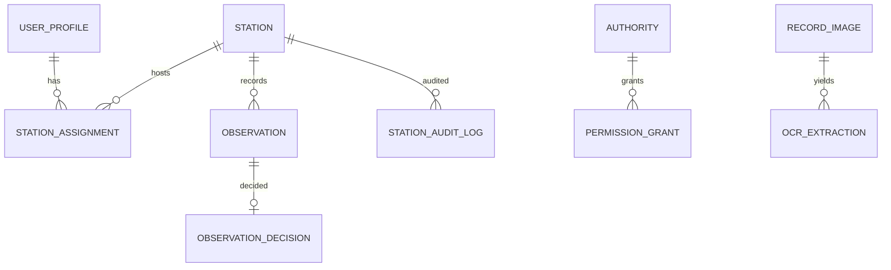

# Logical Data Model (spec only — NOT applied)

Referenced names from project: station_catalogue, permission_grants, station_audit_log, metra_observations, station_assignments, metra_user_profiles; RPCs metra_submit_observation, metra_decide_observation, metra_user_has_station_permission.

No DDL executed in this task.
