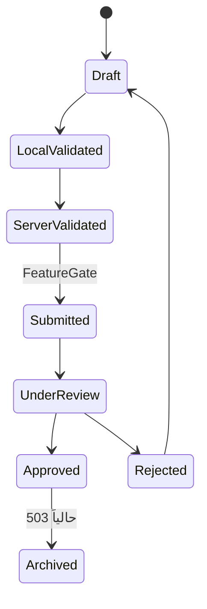

# 05 — سير العمل

## W1 الرصد

Submit: Observer · Decide: Head/Auditor · Archive: 503 حتى الاعتماد.

## W2 أعطال
Report→Assign→InProgress→Resolved→Closed

## W3 تسجيل / W4 منح صلاحية
انظر Authority/Registration endpoints.
