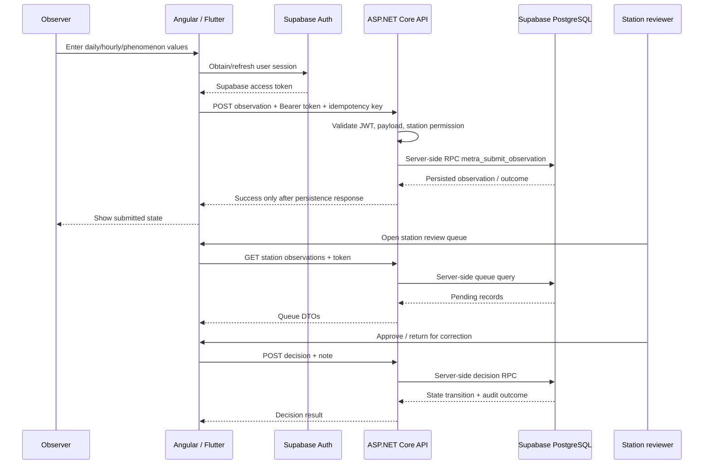

# METRA 2027 — End-to-end data flow

**Status:** Source-supported current flow plus explicitly marked proposed flows.  
**Date:** 2026-11-11

## A. Operational observation flow (implemented in source; runtime still requires verification)

## B. Reports and downstream analysis
1. Persisted, approved observations should be the authoritative source for official reports.
2. Reports must preserve station, observation time, source record, approval state, calculation/version metadata and export timestamp.
3. The current repository README identifies some sample/demo weather and workflow values. Such values must be visibly labelled and excluded from official operational aggregates.
4. This audit did not prove every Angular report page or Flutter screen reads approved records through the API. Report queries and export lineage remain an integration task.

## C. Proposed R / Climatol flow (not evidenced as connected)
1. API or a controlled export job selects an approved, quality-screened time series.
2. Export a versioned, documented input package (station IDs, parameter, units, timestamps/time basis, missing-value convention, source record IDs, quality flags).
3. Run a pinned R + Climatol environment as a separate worker/job, never inside an HTTP request.
4. Store run metadata (R/package versions, configuration, input hash, start/end, logs and warnings).
5. Produce homogenized series and break/quality diagnostics as versioned artifacts.
6. A validation/import step checks schema, units, station mapping and provenance before results become available to reporting.
7. Keep original observations immutable; homogenized values are derived products linked to the input version and run ID.

## D. Proposed paper-register audit flow (not evidenced as connected)
1. Upload original scan/photo to controlled object storage; keep immutable original and cryptographic checksum.
2. Attach station, register type, page/date/hour, uploader, upload time and source device metadata.
3. OCR/vision may propose readings, but must not silently replace electronic observations.
4. Human auditor aligns each paper cell with electronic record using station + parameter + observation time.
5. Record discrepancy type, paper value, electronic value, image/page coordinates, confidence, reviewer and adjudication.
6. API persists audit outcomes and links evidence; corrected operational data follows a separately authorized correction workflow with full audit history.
7. Reports expose reconciliation state and never erase the source evidence.

## E. Data integrity invariants
- The observer's authenticated subject and station authorization are server-derived; never trust client-supplied actor/role.
- Idempotency prevents duplicate submissions on retry.
- Store timestamps canonically in UTC and retain station timezone/local reporting convention as explicit metadata.
- Never fabricate station coordinates or meteorological values.
- Separate drafts/previews from persisted submissions and clearly label demo fixtures.
- Keep legacy database untouched; target only the approved new METRA project.
- No schema/data changes are authorized by this integration audit.
