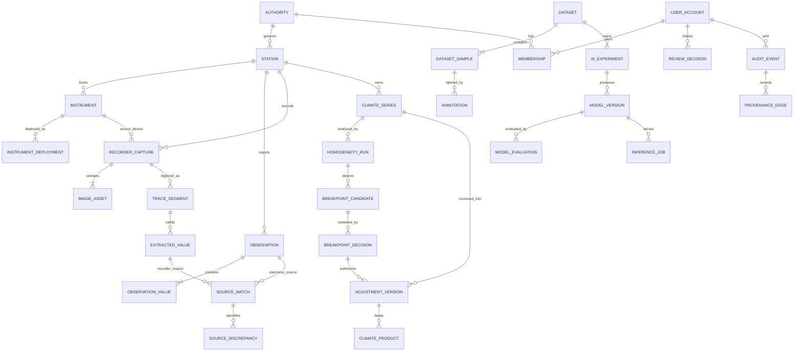

# METRA 2027 — New Scientific Data Model: ERD and Data Dictionary

**Status:** Architecture proposal for review; not executable DDL.  
**Scope:** New METRA application domain for meteorological observations, paper/mechanical recorder digitization, triple-source reconciliation, CLIMATOL-style climate homogenization, and governed AI workflows.  
**Database safety:** No hosted database was queried or changed by this proposal. No legacy schema, legacy station list, or historical records are used as a design source.  
**Implementation target:** PostgreSQL with a provider-neutral .NET domain/API layer. Supabase-specific Auth, storage and RLS adapters remain a separate deployment concern.

---

## 1. Design principles

1. **New domain, not a port of the old system.** The model is organized around scientific provenance, source evidence, review decisions and reproducibility, not legacy table names.
2. **Immutable evidence.** Uploaded originals and imported source observations are never overwritten. Corrections create versioned derivatives with an actor, reason, timestamp and parent reference.
3. **Separate observation from evidence.** A measured value, a chart trace, a scanned page and an OCR candidate are distinct records with explicit relationships.
4. **Station and instrument are first-class.** Every observation and recorder capture is tied to a station, observation time, instrument/source and applicable configuration.
5. **UTC storage, explicit meteorological time.** Store instants as `timestamptz`; retain the station time zone and the reported local date/hour where the source is local-time based. Never silently reinterpret local hours as UTC.
6. **Scientific reproducibility.** Every homogenization run, adjustment, climate product, dataset build and model evaluation records input snapshots, software/config versions and checksums.
7. **No silent scientific correction.** Candidate breakpoints and model outputs remain proposals until reviewed and accepted by an authorized scientist.
8. **Security by scope.** Authorization is checked server-side for authority, station, dataset, job and artifact. Client-supplied actor IDs never establish identity.
9. **Append-only audit.** Decisions and security-relevant events are appended, not edited in place.
10. **No database deployment in this phase.** This document must be reviewed before migrations or hosted changes are generated.

## 2. Bounded contexts

| Context | Responsibility | Owns |
|---|---|---|
| Identity & organization | Tenants/authorities, memberships, roles, station grants | Authority, membership, role, grant |
| Station & instruments | Station catalogue, sensor/instrument metadata and deployment history | Station, instrument, deployment |
| Observation operations | Hourly/daily observations and validation/review | Observation, observation value, decision |
| Recorder digitization | Original images, page metadata, traces and extracted values | Capture, image asset, trace, candidate |
| Source reconciliation | Align and compare paper, mechanical and electronic evidence | Comparison set, matched point, discrepancy |
| Climate science | Homogeneity analysis, breakpoint review, adjustment and climate normals | Series, run, breakpoint, adjustment, product |
| AI governance | Dataset curation, annotation, experiment, model registry and inference | Dataset, sample, annotation, experiment, model |
| Audit & provenance | Immutable lineage, access and scientific decisions | Audit event, provenance edge |

## 3. ERD (logical relationships)

The ERD is logical, not a complete cardinality/DDL specification. All relationships are tenant/authority scoped in the physical model.

## 4. Common column conventions

| Convention | Type | Rule |
|---|---|---|
| Primary key | UUID | Generated server-side; never accepted as proof of authorization |
| Authority scope | UUID | Required on tenant-owned rows; composite FKs enforce same-authority references |
| Created/updated | timestamptz | Server-generated UTC |
| Actor | UUID | Authenticated principal from validated server token |
| Version | integer | Starts at 1; immutable version rows |
| Checksum | char(64) | Lowercase SHA-256 hex for immutable file/input artifacts |
| Metadata | jsonb | Only namespaced, schema-validated extension fields; no authorization facts |
| Scientific unit | text + controlled code | UCUM-compatible unit code where possible; preserve original unit too |
| Quality flags | controlled code set | Do not encode quality state as free-form notes |

## 5. Core identity, authority and station catalogue

### `authority`
- `id uuid PK`
- `code text UNIQUE NOT NULL`: stable authority identifier.
- `name text NOT NULL`, `country_code char(2) NOT NULL`, `status text NOT NULL`.
- `created_at timestamptz NOT NULL`.
- Constraint: `status IN ('active','suspended','retired')`.

### `user_account`
- `id uuid PK`: maps to the configured identity provider subject through a private identity mapping, not a client-supplied ID.
- `display_name text`, `email_normalized text`, `status text NOT NULL`, `created_at timestamptz`.
- Do not store passwords, recovery secrets, access tokens or provider credentials.

### `authority_membership`
- `id uuid PK`, `authority_id uuid FK`, `user_id uuid FK`.
- `role_code text`, `status text`, `valid_from timestamptz`, `valid_to timestamptz NULL`.
- `approved_by uuid NULL`, `approved_at timestamptz NULL`, `reason text`.
- Unique active membership per authority/user/role; revocation is a state transition plus audit event.

### `station`
- `id uuid PK`, `authority_id uuid FK`, `station_code text`, `name text`.
- `latitude numeric(9,6)`, `longitude numeric(9,6)`, `elevation_m numeric(8,2)`.
- `timezone_id text` (IANA), `opened_on date`, `closed_on date NULL`, `status text`.
- `metadata jsonb` for reviewed non-core attributes.
- Unique `(authority_id, station_code)`; latitude/longitude range checks; closed date cannot precede opened date.
- Station code is assigned from the new approved catalogue, never copied from a legacy station list.

### `station_assignment`
- `id uuid PK`, `authority_id uuid FK`, `station_id uuid FK`, `user_id uuid FK`, `role_code text`.
- `status text`, `valid_from timestamptz`, `valid_to timestamptz NULL`, approval actor/time.
- Composite FK ensures station belongs to the same authority; overlapping active assignments for same user/station/role are prohibited.

## 6. Instrument inventory and deployments

### `instrument`
- `id uuid PK`, `authority_id uuid FK`, `instrument_code text`, `instrument_type text`.
- `manufacturer text NULL`, `model text NULL`, `serial_number text NULL`, `measurement_family text`.
- `resolution numeric NULL`, `unit_code text NULL`, `calibration_interval_days integer NULL`, `status text`.
- `instrument_type` examples: thermometer, hygrometer, barometer, rain_gauge, thermograph, hygrograph, barograph, pluviograph, electronic_logger.
- Unique authority/instrument code; calibration interval must be positive when present.

### `instrument_deployment`
- `id uuid PK`, `instrument_id uuid FK`, `station_id uuid FK`.
- `installed_at timestamptz`, `removed_at timestamptz NULL`, `exposure_metadata jsonb`.
- `calibration_certificate_asset_id uuid NULL`, `configuration_version integer`.
- Deployment intervals for one instrument must not overlap; all referenced station/instrument rows must share authority.

## 7. Operational observations

### `observation`
- `id uuid PK`, `authority_id uuid FK`, `station_id uuid FK`.
- `observation_kind text`: hourly, daily, synoptic, climate_summary or an approved controlled kind.
- `observed_at timestamptz`, `reported_local_date date`, `reported_local_hour smallint NULL`, `timezone_id text`.
- `source_kind text`: manual, electronic, imported, recorder_derived.
- `status text`: draft, submitted, in_review, approved, returned, superseded.
- `supersedes_observation_id uuid NULL`, `submitted_by uuid NULL`, `submitted_at timestamptz NULL`.
- Unique idempotency key per authority/client submission; unique natural key must be defined per observation kind and station cadence.
- Approved/superseded observations are immutable; correction creates a new version linked through supersedes.

### `observation_value`
- `id uuid PK`, `observation_id uuid FK`, `variable_code text`, `value_numeric numeric NULL`, `value_text text NULL`.
- `unit_code text NULL`, `quality_code text`, `original_value_text text NULL`, `uncertainty numeric NULL`.
- Exactly one of numeric/text values is populated unless a variable's schema explicitly allows a compound value.
- Variable metadata is held in a controlled `variable_definition` catalogue: code, name, dimension, canonical unit, allowed range, cadence and validation profile.

### `review_decision`
- `id uuid PK`, `authority_id uuid FK`, `subject_type text`, `subject_id uuid`.
- `decision text`: approve, reject, return, accept_candidate, reject_candidate, publish, revoke.
- `reason text NOT NULL`, `actor_user_id uuid FK`, `decided_at timestamptz`.
- Decisions are append-only; current status is a projection from the decision history.

## 8. Paper and mechanical recorder digitization

### `recorder_capture`
- `id uuid PK`, `authority_id uuid FK`, `station_id uuid FK`, `instrument_id uuid FK`.
- `recorder_kind text`: thermograph, hygrograph, barograph, pluviograph.
- `capture_start timestamptz`, `capture_end timestamptz`, `paper_timezone_id text`.
- `chart_type text`, `chart_scale jsonb`, `operator_user_id uuid`, `status text`.
- Capture interval must be positive and must overlap the instrument's deployment interval.

### `image_asset`
- `id uuid PK`, `authority_id uuid FK`, `capture_id uuid FK`.
- `storage_object_key text UNIQUE` (opaque private key; never a public URL), `original_file_name text`.
- `media_type text`, `byte_length bigint`, `sha256 char(64)`, `pixel_width integer`, `pixel_height integer`.
- `uploaded_by uuid FK`, `uploaded_at timestamptz`, `scan_status text`, `retention_class text`.
- Original bytes are immutable. Store privately, quarantine until malware/content scanning completes, and serve via short-lived authorized access. Never trust a client-provided object key.

### `trace_segment`
- `id uuid PK`, `capture_id uuid FK`, `image_asset_id uuid FK`, `channel_code text`.
- `geometry jsonb` (versioned normalized pixel-coordinate polyline), `digitization_method text`, `algorithm_version text`.
- `created_by uuid NULL`, `created_at timestamptz`, `review_status text`.
- Coordinates are tied to the immutable image checksum and image dimensions.

### `extracted_value`
- `id uuid PK`, `trace_segment_id uuid FK`, `variable_code text`, `observed_at timestamptz`.
- `value_numeric numeric`, `unit_code text`, `uncertainty numeric NULL`, `confidence numeric NULL`.
- `extraction_method text`, `algorithm_version text`, `review_status text`, `reviewed_by uuid NULL`.
- Machine output is a candidate, not an accepted observation until reviewed under policy.

## 9. Triple-source comparison and provenance

### `source_match`
- `id uuid PK`, `authority_id uuid FK`, `station_id uuid FK`, `variable_code text`.
- `comparison_window_start timestamptz`, `comparison_window_end timestamptz`.
- `electronic_observation_value_id uuid NULL`, `recorder_extracted_value_id uuid NULL`, `manual_value_id uuid NULL`.
- `alignment_method text`, `tolerance numeric NULL`, `status text`, `created_at timestamptz`.
- At least two source references must exist; source station/variable/time compatibility is validated by service/domain rules.

### `source_discrepancy`
- `id uuid PK`, `source_match_id uuid FK`, `difference_numeric numeric NULL`, `difference_percent numeric NULL`.
- `severity text`, `reason_code text`, `resolution_status text`, `resolution_note text NULL`.
- Store raw source values and their IDs; never overwrite a source value to make the comparison pass.

### `provenance_edge`
- `id uuid PK`, `authority_id uuid FK`, `from_type text`, `from_id uuid`, `to_type text`, `to_id uuid`.
- `relationship text`, `created_at timestamptz`, `created_by uuid NULL`, `metadata jsonb`.
- Represents derived-from, digitized-from, corrected-from, trained-on, evaluated-by and published-as lineage.

## 10. Climate series and homogenization

### `climate_series`
- `id uuid PK`, `authority_id uuid FK`, `station_id uuid FK`, `variable_code text`.
- `frequency text`: daily, monthly, annual; `unit_code text`, `series_start date`, `series_end date`.
- `source_policy text`, `status text`, `created_at timestamptz`.
- One series represents one station, variable, frequency and source policy. Values reference approved observation/source records or a versioned import snapshot.

### `homogeneity_run`
- `id uuid PK`, `authority_id uuid FK`, `target_series_id uuid FK`.
- `method_code text`, `software_name text`, `software_version text`, `configuration jsonb`.
- `input_snapshot_sha256 char(64)`, `reference_series_ids uuid[]`, `started_at timestamptz`, `completed_at timestamptz NULL`.
- `status text`, `execution_log_asset_id uuid NULL`, `initiated_by uuid`.
- Run is reproducible from immutable input snapshot + method/software/config versions. Do not mutate inputs in place.

### `breakpoint_candidate`
- `id uuid PK`, `homogeneity_run_id uuid FK`, `candidate_date date`, `statistic_code text`.
- `statistic_value numeric`, `p_value numeric NULL`, `magnitude numeric NULL`, `confidence numeric NULL`.
- `evidence jsonb`, `status text`.
- Candidate is not a correction and must not alter the source series.

### `breakpoint_decision`
- `id uuid PK`, `breakpoint_candidate_id uuid FK`, `decision text`, `reviewer_user_id uuid FK`.
- `reason text`, `evidence_asset_ids uuid[]`, `decided_at timestamptz`.
- Append-only; a changed decision creates another decision event.

### `adjustment_version`
- `id uuid PK`, `authority_id uuid FK`, `series_id uuid FK`, `homogeneity_run_id uuid FK`.
- `version integer`, `method_code text`, `adjustment_parameters jsonb`, `input_snapshot_sha256 char(64)`.
- `output_asset_id uuid`, `status text`, `approved_by uuid NULL`, `approved_at timestamptz NULL`.
- Unique (series_id, version); no overwrite of prior versions. Publication requires approved breakpoint decisions and an explicit approval decision.

### `climate_product`
- `id uuid PK`, `authority_id uuid FK`, `product_type text`, `period_start date`, `period_end date`.
- `input_series_ids uuid[]`, `adjustment_version_ids uuid[]`, `method_version text`, `artifact_asset_id uuid`.
- `status text`, `published_by uuid NULL`, `published_at timestamptz NULL`.
- Product records its exact input series/adjustment versions and can be rebuilt.

## 11. AI dataset, training and model governance

### `dataset`
- `id uuid PK`, `authority_id uuid FK`, `name text`, `purpose text`, `schema_version text`.
- `status text`, `created_by uuid`, `created_at timestamptz`, `snapshot_sha256 char(64) NULL`.
- Dataset definition is versioned; each build produces an immutable snapshot.

### `dataset_sample`
- `id uuid PK`, `dataset_id uuid FK`, `source_type text`, `source_id uuid`.
- `station_id uuid FK`, `time_start timestamptz`, `time_end timestamptz`.
- `split text`: train, validation, test; `sample_sha256 char(64)`, `exclusion_reason text NULL`.
- Enforce split isolation by station and/or time block according to the experiment's declared leakage policy. Test samples cannot be silently moved into training after evaluation.

### `annotation`
- `id uuid PK`, `dataset_sample_id uuid FK`, `label_schema_version text`, `label_payload jsonb`.
- `annotator_user_id uuid FK`, `reviewer_user_id uuid NULL`, `status text`, `created_at timestamptz`.
- Label payload must validate against a versioned schema; changes create new annotation versions.

### `ai_experiment`
- `id uuid PK`, `authority_id uuid FK`, `dataset_id uuid FK`, `dataset_snapshot_sha256 char(64)`.
- `task_type text`, `algorithm text`, `code_revision text`, `hyperparameters jsonb`, `environment_digest text`.
- `started_at timestamptz`, `completed_at timestamptz NULL`, `status text`, `initiated_by uuid`.
- Must record random seed, data split manifest, metrics and training artifact checksums.

### `model_version`
- `id uuid PK`, `experiment_id uuid FK`, `model_name text`, `version text`, `artifact_asset_id uuid`.
- `model_card jsonb`, `status text`, `created_at timestamptz`, `approved_by uuid NULL`, `approved_at timestamptz NULL`.
- Model is not deployable until evaluation gates and human approval pass.

### `model_evaluation`
- `id uuid PK`, `model_version_id uuid FK`, `dataset_snapshot_sha256 char(64)`, `split text`.
- `metrics jsonb`, `evaluation_code_revision text`, `evaluated_at timestamptz`, `passed boolean`.
- Test metrics are immutable and tied to the exact model and dataset snapshot.

### `inference_job`
- `id uuid PK`, `model_version_id uuid FK`, `input_asset_id uuid NULL`, `input_snapshot_sha256 char(64)`.
- `requested_by uuid`, `status text`, `result_asset_id uuid NULL`, `started_at timestamptz`, `completed_at timestamptz NULL`.
- Every result retains model version, input checksum, configuration and provenance; inference never silently writes accepted observations.

## 12. Audit, security and lifecycle constraints

### `audit_event`
- `id uuid PK`, `authority_id uuid NULL`, `actor_user_id uuid NULL`, `event_code text`.
- `subject_type text`, `subject_id uuid`, `occurred_at timestamptz`, `request_id uuid`.
- `before_digest char(64) NULL`, `after_digest char(64) NULL`, `reason text NULL`, `metadata jsonb`.
- Append-only; deny UPDATE/DELETE to application roles; retention and export are governed policies.

### Required database/service invariants
- Composite foreign keys or equivalent constraints prevent cross-authority references.
- Every file object is private and addressed by opaque storage key; signed URLs are short-lived and authorized per request.
- Upload intake has size/type/signature/hash checks, malware scanning/quarantine, safe decode/re-encode and EXIF policy before preview.
- No direct client write access to scientific/audit tables. All writes go through authenticated .NET application services or reviewed server-side functions.
- Idempotency keys are scoped to actor + operation + resource and have unique constraints.
- Long-running jobs use explicit states: queued, validating, running, succeeded, failed, cancelled; retry attempts are recorded separately.
- Use optimistic concurrency/version columns for reviewable entities; reject stale decisions.
- Audit actor identity is derived from validated JWT; never trust actor IDs in request bodies.
- RLS policies, storage policies and .NET authorization must agree; tests must include cross-authority and cross-station denial.
- Secrets and provider keys are held only in a managed secret store; never in Flutter assets, client configuration or logs.

## 13. Index and partition strategy

- B-tree: `(authority_id, station_id, observed_at DESC)` for observation retrieval.
- B-tree: `(station_id, variable_code, observed_at)` for series assembly.
- B-tree: `(capture_id, uploaded_at)` and unique `(sha256, authority_id)` where duplicate policy permits.
- GIST/BRIN only where measured query plans justify them; BRIN is a candidate for large time-ordered observation tables.
- Partition high-volume observations and audit events by time only after workload/retention sizing; keep stable parent keys and enforce authority scoping.
- Index all foreign keys used for authorization and joins; avoid indiscriminate JSONB indexes.

## 14. Open decisions to settle in schema review

1. Authority tenancy model: one authority per deployment or multiple authorities per database.
2. Variable catalogue and canonical unit policy (recommend UCUM codes + preserved source unit/value).
3. Observation cadence/natural keys for each report family.
4. Image retention, data residency, malware scanner and quarantine provider.
5. Whether AI artifacts live in private object storage or a dedicated model registry.
6. Climate-series storage: normalized rows vs immutable columnar artifacts for large homogeneous datasets.
7. Whether CLIMATOL is invoked as an external worker/container or a separately versioned service.
8. Scientific approval roles and dual-control rules for adjustment publication.
9. Retention/legal hold rules for originals, audit events and derived outputs.
10. Exact identity provider and subject mapping strategy.

## 15. Approval gate and next implementation sequence

This proposal must be reviewed before any executable migration is generated. Recommended sequence:

1. Confirm authority/station tenancy, variable/unit catalogue and observation natural keys.
2. Produce PostgreSQL DDL for a **disposable empty test database only**, including constraints and indexes.
3. Add migration replay and cross-tenant/station authorization tests in CI.
4. Add .NET persistence interfaces and repositories against the isolated database.
5. Add reviewed staging-only schema deployment with synthetic data.
6. Wire Flutter only to authenticated .NET APIs; never directly to privileged database credentials.
7. Build recorder upload/quarantine service, then OCR and trace digitization.
8. Implement triple-source reconciliation and reviewer workflow.
9. Implement CLIMATOL job adapter and immutable adjustment lineage.
10. Implement dataset snapshots, leakage-safe AI training/evaluation and governed model registry.

**No production DDL, Supabase migration, data seed, or hosted write is authorized by this document.**

## 16. Live physical-schema comparison snapshot (2026-11-15)

A read-only inspection of the current Supabase project found 46 application tables across `iam`, `catalog`, `ref`, `files`, `observations`, `weather`, `alerts`, `operations`, `integration`, and `audit`. The deployed physical dictionary, including columns, defaults, checks, primary keys, foreign keys, RLS state and metadata row counts, is captured in:

`docs/architecture/METRA-LIVE-SUPABASE-PHYSICAL-DICTIONARY-2026-11-15.md`

This logical ERD remains a proposal for the complete scientific platform. The live schema does not yet contain the recorder capture/image/trace, climate homogenization/adjustment, or AI dataset/experiment/model-registry tables described in this proposal. Review the live physical snapshot against this logical target and the recovered live migration history before preparing any new migration. No DDL approval is implied by either document.
