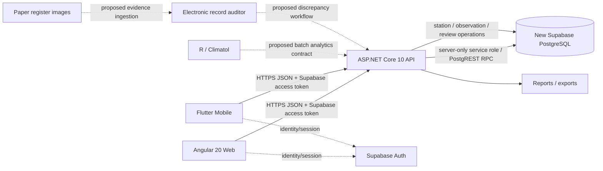

# METRA 2027 — System integration audit

**Audit date:** 2026-11-11  
**Branch:** `assistant-12/system-integration-audit`  
**Baseline:** `main`  
**Method:** Read-only inspection of repository files. No database calls, migrations, deployments, or runtime end-to-end requests were performed.

## 1. Evidence-based system map

Solid edges are supported by inspected code or repository documentation. Dashed edges are proposed or not yet evidenced as implemented.

### Runtime responsibilities
- Angular is the web client; routes are declared in `angular-app/src/app/app.routes.ts`.
- Flutter is a separate mobile client. `main.dart` gates app access on Supabase and API configuration.
- ASP.NET Core is the central API and privileged Supabase access boundary.
- Supabase Auth supplies user access tokens. The API validates JWT issuer/audience and applies a fallback authenticated-user policy.
- Supabase PostgREST/RPC is called from server-side feature services using the service-role key.
- R/Climatol and paper-image auditing are not demonstrated as connected runtime services by the inspected files.

## 2. Verified implementation details

### Angular → API
`angular-app/src/app/core/api/observation-api.service.ts`:
- obtains a Supabase access token through `SupabaseAuthService`;
- calls `GET /api/v1/stations`;
- submits observations to `POST /api/v1/stations/{stationId}/observations`;
- reads a review queue and posts decisions;
- validates identifiers and basic request shape client-side.

`hourly-reports.component.ts` imports this service and explicitly distinguishes local previews/drafts from server submissions. The presence of other routes does not prove those screens persist to the API.

### Flutter → API
`mobile/metra_mobile/lib/core/api/metra_api_client.dart`:
- obtains a token from an injected access-token provider;
- calls station directory, review queue, decision and submission endpoints;
- serializes submission timestamps as UTC ISO-8601;
- rejects non-2xx responses.
`api_config.dart` accepts an HTTPS origin only, with no path/query/fragment. The API client appends versioned paths itself. `main.dart` requires both Supabase and API configuration before opening the authenticated app.

### API → Supabase
`backend/Metra.Api/Program.cs` registers feature services, bounded 8-second named HttpClients, JWT bearer validation, fallback authorization, CORS, endpoint maps, health and readiness.
`ObservationSubmissionEndpoints.cs` calls RPC `metra_submit_observation`; the station directory service reads `station_catalogue` and its current `station_coordinates` projection. Readiness performs a server-authenticated catalogue request, not merely a configuration-presence check.

### Deployment boundary
The repository documentation states that a published container is not a deployed API. No production host is recorded. Pages deployment was previously blocked by an empty `METRA_API_BASE_URL` secret. Live integration must not be inferred from successful builds or endpoint declarations.

## 3. Contract observations and risks
1. Angular and Flutter agree on the station directory endpoint and snake_case station response fields.
2. Both clients target the same observation submission route and send camelCase request properties. Verify the deployed API's JSON serializer settings and contract tests remain aligned.
3. Flutter sends `observedAt` in UTC; Angular sends its supplied ISO timestamp. Domain policy must explicitly define canonical UTC storage and station-local display/time semantics.
4. API accepts observation types `daily`, `hourly`, `phenomenon`; detailed meteorological payload schemas are not proven by this endpoint-level inspection.
5. API service-role use is server-side, which is the intended trust boundary. Confirm secrets are absent from client bundles and logs in CI/security scans.
6. Supabase service methods call named RPCs/projections; migration/schema contract tests must prove every referenced function, table, column and policy exists in the approved new project.
7. Angular route guards are client navigation controls only. API authorization remains authoritative.

## 4. Known gaps / unverified areas
- No live deployed HTTPS API origin was verified in this audit.
- No authenticated browser/device-to-API end-to-end request was executed.
- Angular routes for climate, rainfall, monthly/annual reports, agriculture, soil and user administration were not individually proven to persist via API. Treat them as unverified until each feature is traced.
- Flutter's API client covers directory and observation workflow operations in the inspected file; full feature parity with Angular is not established.
- No R/Climatol executable, worker, job contract, result ingestion endpoint or CI runtime was verified.
- No paper register image upload/storage/OCR/manual verification workflow was verified.
- No evidence from this audit proves all mock/demo values have been removed. README explicitly warns some weather/workflow values remain demo/sample data.
- The three requested `واجهات/*` tracking files were absent on `main`; this branch adds initial cumulative trackers rather than overwriting existing content.

## 5. Verification required before calling an edge integrated
For each edge: inspect the actual caller and callee; verify matching route, HTTP verb, auth header, request/response schema and error semantics; run unit/contract tests; run authenticated integration tests against an isolated non-production environment; record request IDs/results and test commit. Never use operational fake observations.

## 6. Non-goals observed
No database schema or data was changed. No legacy database was accessed. No deployment was performed. No other assistant's implementation files were modified.
